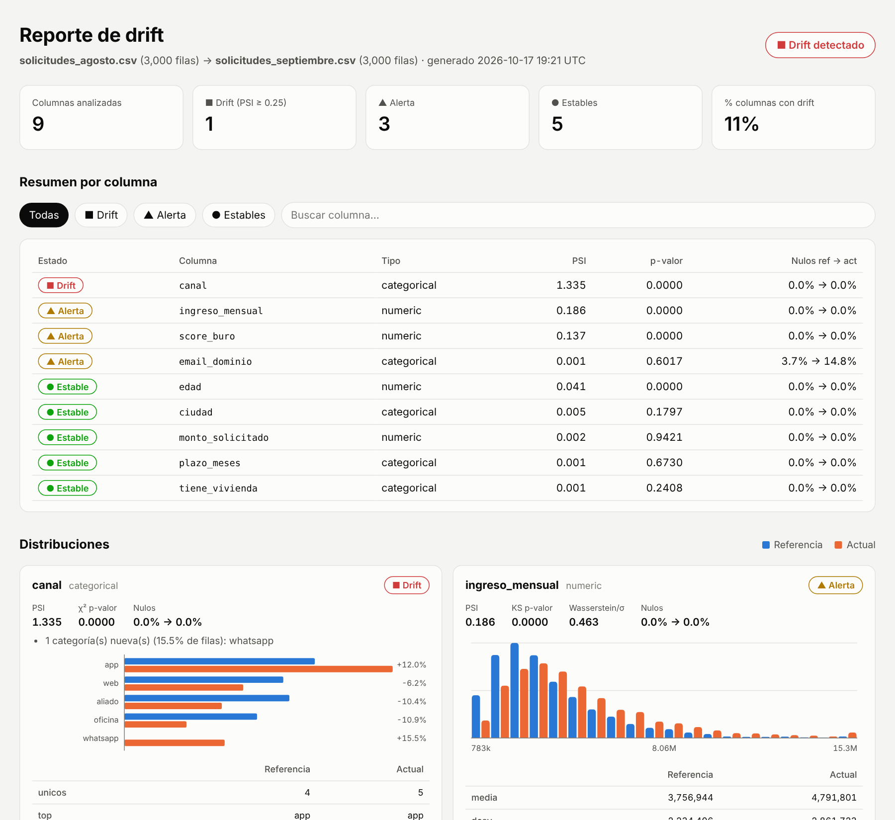

<div align="center">

# 📡 driftradar

**¿Tus datos de hoy se parecen a los de ayer?** Compara dos versiones de un dataset, detecta qué
columnas cambiaron y genera un reporte listo para compartir, en un solo comando.

[](https://github.com/johnbyronA/drift-radar/actions/workflows/ci.yml)


[](LICENSE)


[**Ver reporte de ejemplo en vivo**](https://johnbyrona.github.io/drift-radar/) ·
[Metodología](docs/metodologia.md) ·
[English summary](#english-summary)



</div>

---

## El problema

Un tablero que de repente "muestra cosas raras", un modelo que pierde precisión sin razón aparente,
una carga mensual que llega con un campo vacío o un canal nuevo que nadie avisó. En casi todos los
casos la causa es la misma: **los datos cambiaron** y nadie lo detectó a tiempo.

driftradar es una herramienta liviana (solo `pandas`, `numpy` y `scipy`) que responde, columna por
columna:

- ¿Cambió la distribución? → **PSI** (magnitud) + **Kolmogorov–Smirnov / χ²** (significancia)
- ¿Cambió la calidad? → tasa de **nulos**, **categorías nuevas**, valores **fuera de rango**
- ¿Cambió la estructura? → columnas **nuevas, eliminadas** o con **otro tipo**

Y lo entrega en tres formatos: **HTML** para personas, **JSON** para sistemas y **Markdown** para
GitHub Actions. Con códigos de salida pensados para usarlo como *quality gate* en un pipeline.

## Inicio rápido (1 minuto)

```bash
pip install "git+https://github.com/johnbyronA/drift-radar.git"

# Genera datos sintéticos y un reporte de ejemplo
driftradar demo
# → abre driftradar-demo/reporte.html
```

Con tus propios archivos (CSV, TSV, Parquet, JSON, JSON Lines o Excel):

```bash
driftradar compare ventas_2026-08.csv ventas_2026-09.csv \
  --exclude id,fecha_carga \
  --html reporte.html --json reporte.json
```

```text
driftradar 1.0.0 · 3,000 → 3,000 filas · estado global: DRIFT
  [DRIFT] canal             PSI  1.335  categorical
  [WARN ] ingreso_mensual   PSI  0.186  numeric
  [WARN ] score_buro        PSI  0.137  numeric
  [WARN ] email_dominio     PSI  0.001  categorical
  [OK   ] edad              PSI  0.041  numeric
  [OK   ] ciudad            PSI  0.005  categorical
  ...
```

## Uso desde Python / notebooks

```python
import driftradar
from driftradar import Config

ref = driftradar.read_table("agosto.parquet")
cur = driftradar.read_table("septiembre.parquet")

report = driftradar.compare(ref, cur, Config(psi_drift=0.2, exclude=["id"]))

report.status            # 'ok' | 'warning' | 'drift'
report.drifted_columns   # ['canal']
report.to_frame()        # DataFrame con resultados por columna
open("reporte.html", "w").write(report.to_html())
```

## Úsalo en CI (GitHub Actions)

driftradar trae una *action* propia. El resumen aparece en la pestaña **Summary** del job y el job
falla si hay drift (configurable).

```yaml
- uses: actions/checkout@v4
- uses: johnbyronA/drift-radar@v1.0.0
  with:
    reference: data/referencia.csv
    current: data/nuevo.csv
    exclude: id,fecha
    fail-on: drift        # drift | warning | never
```

Ver el ejemplo completo en [`.github/workflows/drift-example.yml`](.github/workflows/drift-example.yml).

**Códigos de salida del CLI:** `0` sin problemas · `1` drift (o alerta, según `--fail-on`) ·
`2` error de uso o de lectura.

## Docker

```bash
docker build -t driftradar .
docker run --rm -v "$PWD:/data" driftradar compare ref.csv cur.csv --html reporte.html
```

Imagen multi-stage, usuario sin privilegios, sin dependencias de compilación.

## Configuración

Por argumentos (`--psi-warning`, `--psi-drift`, `--columns`, `--exclude`, ...) o con un archivo
TOML (`--config driftradar.toml`, también lee `[tool.driftradar]` de `pyproject.toml`):

```toml
psi_warning = 0.10
psi_drift = 0.25
null_rate_warning = 0.05
exclude = ["id_solicitud", "fecha"]
```

Todas las opciones en [`driftradar.example.toml`](driftradar.example.toml).

## Cómo decide el estado

| PSI | Estado |
|---|---|
| < 0.10 | 🟢 Estable |
| 0.10 – 0.25 | 🟡 Alerta |
| ≥ 0.25 | 🔴 Drift |

Además, un cambio de ≥ 5 puntos porcentuales en nulos sube la columna a 🟡 como mínimo, y una
columna eliminada pone el reporte completo en 🔴. El p-valor se informa pero **no** decide el estado,
porque con muchas filas casi todo resulta "significativo". Detalle y fórmulas en
[docs/metodologia.md](docs/metodologia.md).

## Casos de uso

- **Cargas periódicas (ETL):** validar el archivo del mes antes de publicarlo en el tablero.
- **Monitoreo de modelos (MLOps):** comparar los datos de *scoring* contra los de entrenamiento.
- **Migraciones:** verificar que el sistema nuevo entrega los mismos datos que el anterior.
- **Auditoría de datos:** documentar con evidencia qué cambió entre dos cortes.

## Estructura del proyecto

```
drift-radar/
├── src/driftradar/
│   ├── core.py          # compare() y DriftReport
│   ├── metrics.py       # PSI, KS, χ², Wasserstein
│   ├── config.py        # umbrales + carga TOML
│   ├── io.py            # lectura CSV/Parquet/JSON/Excel
│   ├── cli.py           # interfaz de línea de comandos
│   ├── datasets.py      # datos sintéticos para demo
│   └── report/          # HTML autocontenido y Markdown
├── tests/               # 35 pruebas · cobertura 97 %
├── examples/            # datos de ejemplo + quickstart.py
├── docs/                # metodología, capturas, reporte de ejemplo (GitHub Pages)
├── action.yml           # GitHub Action reutilizable
├── Dockerfile
└── pyproject.toml
```

## Desarrollo

```bash
git clone https://github.com/johnbyronA/drift-radar.git && cd drift-radar
make install   # pip install -e ".[dev]"
make test      # pytest + cobertura (mínimo 85 %)
make lint      # ruff
```

Los datos de ejemplo son **100 % sintéticos** (solicitudes de crédito simuladas); el repositorio no
contiene datos reales ni personales.

## Hoja de ruta

- [ ] Drift multivariado (clasificador de dominio)
- [ ] Comparación por segmentos (`--by region`)
- [ ] Lectura directa desde SQL / Databricks
- [ ] Publicación en PyPI

---

## English summary

**driftradar** compares two versions of a tabular dataset and reports which columns drifted,
using PSI (magnitude), Kolmogorov–Smirnov / chi-square (significance), null-rate changes, new
categories, out-of-range values and schema changes. It outputs a self-contained HTML report
(light/dark, filterable), JSON and Markdown, ships as a CLI, Python library, Docker image and
reusable GitHub Action, and returns CI-friendly exit codes. MIT licensed.

```bash
pip install "git+https://github.com/johnbyronA/drift-radar.git"
driftradar demo
```

## Autor

**John Byron Alzate Hernández** · Analista de datos · Medellín, Colombia
[GitHub](https://github.com/johnbyronA)

Licencia [MIT](LICENSE).
